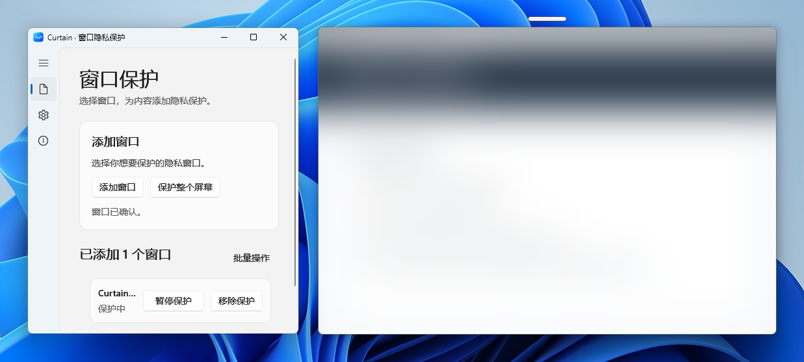
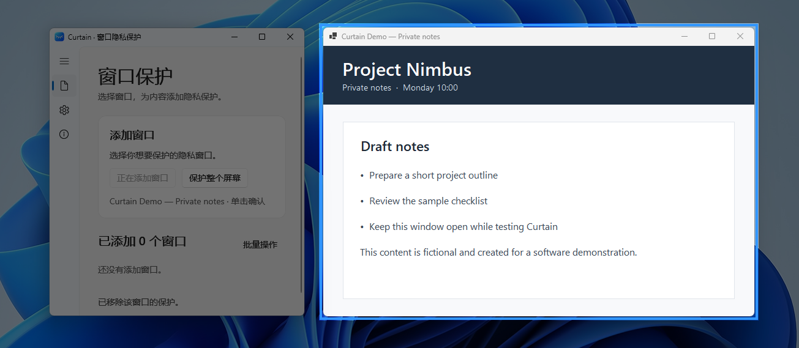
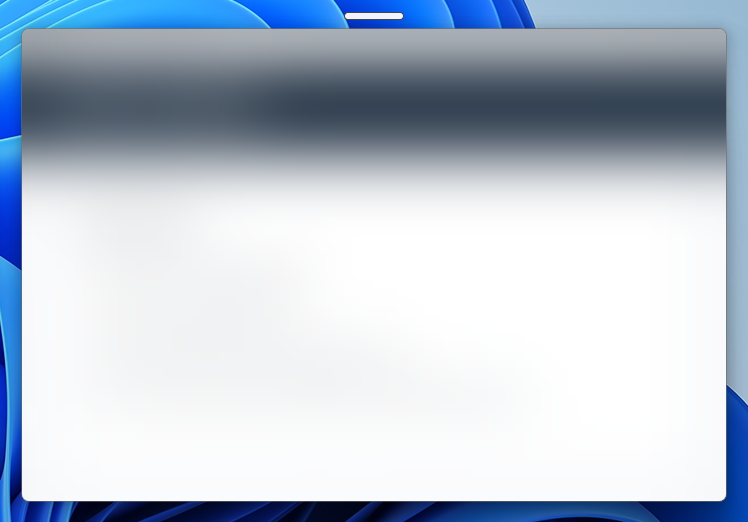
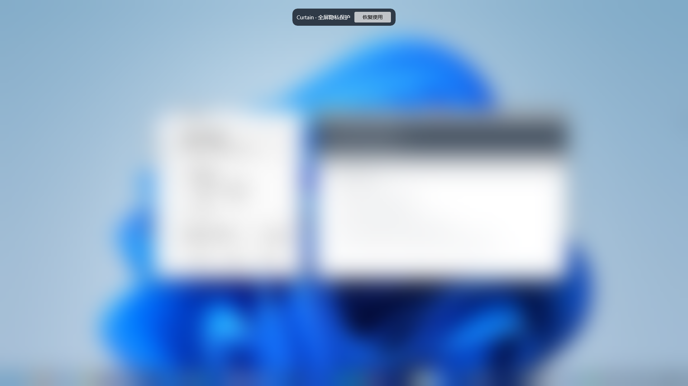
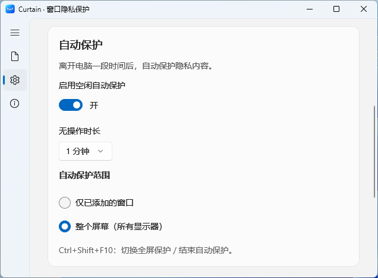

# Curtain

### Privacy when you need it. Clarity when you don't.

A lightweight frosted-glass privacy shield for Windows. Cover one window, protect your whole desktop, or let Curtain step in automatically when you step away.

  
  
  
  

**[Download for Windows](https://curtain-updates.cheneylab.cn/beta/CurtainPrivacy-0.2.0-beta.5.4-Setup.exe)** · **[GitHub Release](https://github.com/Cheney-0821/Curtain/releases/tag/v0.2.0-beta.5.4)** · **[简体中文](README.zh-CN.md)**

Windows x64 · Unsigned beta · Windows 11 tested

---

  

  Real Curtain screenshot. The sample app, Project Nimbus, contains fictional content.

## One privacy tool, three simple ways to use it

<table>
  <tr>
    <td width="33%" align="center"><b>Pick a window</b></td>
    <td width="33%" align="center"><b>Toggle in one click</b></td>
    <td width="33%" align="center"><b>Shield the whole desktop</b></td>
  </tr>
  <tr>
    <td></td>
    <td></td>
    <td></td>
  </tr>
  <tr>
    <td>Hover to highlight a window, then click to add it to Curtain.</td>
    <td>Use the slim handle above a protected window to show or hide its contents.</td>
    <td>Cover your desktop with a single action, including connected displays.</td>
  </tr>
</table>

## Made for the moments you step away

Curtain can watch for a period of keyboard and mouse inactivity and start protection automatically. You choose both **when** and **what** to protect.

<table>
  <tr>
    <td width="48%" align="center"></td>
    <td valign="middle">
      <b>Automatic protection</b>
      <ul>
        <li>Choose 1, 3, 5 or 10 minutes of inactivity.</li>
        <li>Protect only added windows, or all displays.</li>
        <li>Automatic protection is off by default.</li>
        <li>Explicitly end a protection session; ordinary mouse movement won't instantly reveal everything.</li>
        <li>Manual window preferences are preserved when an automatic session ends.</li>
      </ul>
    </td>
  </tr>
</table>

## Designed to stay out of the way

- **Independent window controls.** Protect multiple chosen windows without blurring everything else.
- **A small, responsive handle.** Quick to toggle, attached to the window as it moves or resizes.
- **Whole-desktop privacy.** Manual full-screen protection, including multi-monitor coverage.
- **Smart idle behavior.** Temporarily uncover an individual window during an idle-protection session; when the next idle threshold is reached, Curtain protects it again.
- **Updates without surprise restarts.** Check and download updates in the background; you decide when to install and restart.
- **Taskbar-friendly minimize.** Minimize Curtain to the taskbar; closing the window still sends it to the tray.
- **Native Windows feel.** Built with WinUI 3 and Windows App SDK.

## Get started

1. **Download** the [current Windows x64 beta installer](https://curtain-updates.cheneylab.cn/beta/CurtainPrivacy-0.2.0-beta.5.4-Setup.exe). This installer is **not code-signed**; Windows may warn that its publisher is unrecognized. Verify the source and do not disable security protections just to install it.
2. **Launch Curtain** and choose **Add window** or **Protect entire screen**.
3. **Set your preferences** in Settings if you want Curtain to activate after inactivity.

> The source commit used for this release is recorded in the GitHub Release notes.

<b>Keyboard shortcuts and compatibility</b>

| Shortcut | Action |
|---|---|
| <kbd>Ctrl</kbd> + <kbd>Shift</kbd> + <kbd>F9</kbd> | Enter window selection |
| <kbd>Ctrl</kbd> + <kbd>Shift</kbd> + <kbd>F10</kbd> | Toggle whole-desktop protection or end the current automatic protection session |

Curtain targets Windows x64. The project's minimum Windows target is Windows 10 version 2004 (build 19041), but independent Windows 10 runtime testing has not yet been completed. The current beta has been tested primarily on Windows 11.

## What Curtain is — and isn't

Curtain is a **visual privacy overlay**, not a Windows sign-in lock, a defense against screenshots/recording, or a security boundary. Some notifications or transient popups may briefly appear above the full-screen overlay before its Z-order is recovered. Blur strength is not yet adjustable, and the list of currently protected running windows does not persist after restarting Curtain.

## Feedback and open source

Curtain's source code is publicly available under **GPL-3.0-only**. Use [GitHub Issues](https://github.com/Cheney-0821/Curtain/issues) to report bugs or suggest improvements.

The current beta installer and in-app update feed are hosted on the official update domain above. The [GitHub Release](https://github.com/Cheney-0821/Curtain/releases/tag/v0.2.0-beta.5.4) includes release notes, the source commit, the installer SHA-256, and a GitHub-hosted installer mirror.

## License

Curtain's own code is licensed under **GPL-3.0-only**. See [LICENSE](LICENSE).
Third-party components retain their respective licenses. See [THIRD-PARTY-NOTICES.md](THIRD-PARTY-NOTICES.md) and the archived texts in [licenses/third-party](licenses/third-party).

Curtain is an independent application and is not affiliated with or endorsed by Microsoft. Windows and other third-party marks and imagery belong to their respective owners. The real-world Windows 11 desktop screenshots are included solely to demonstrate Curtain running on Windows.
