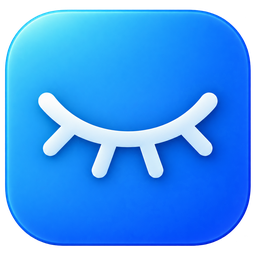
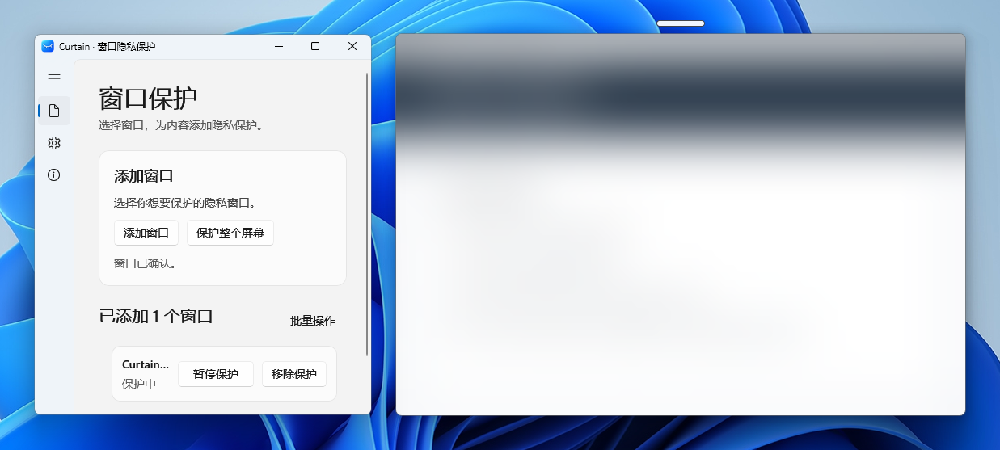
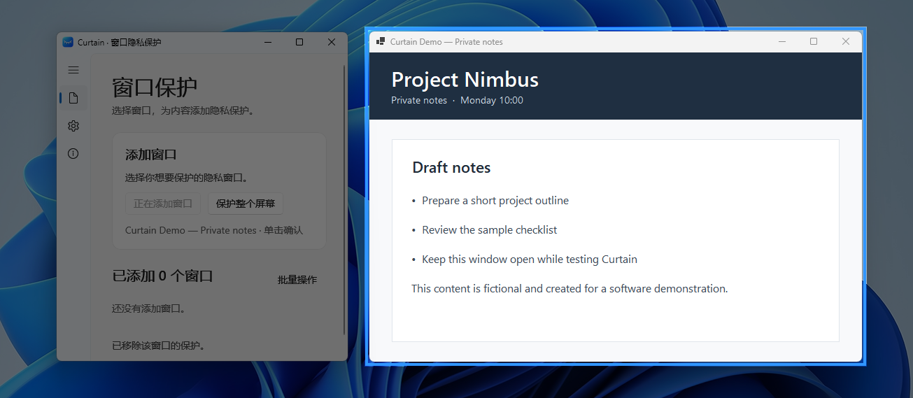
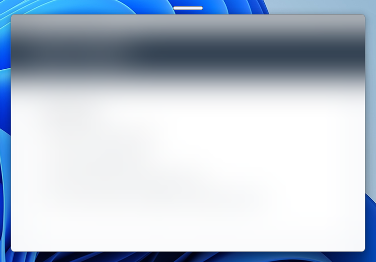
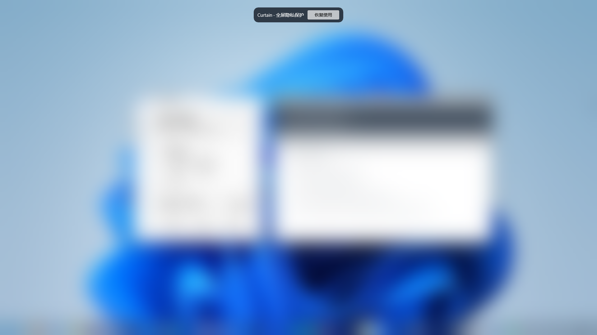
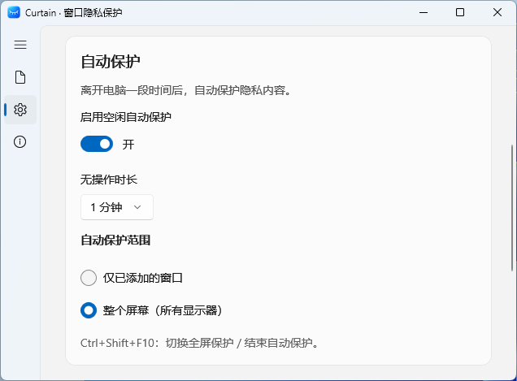

# Curtain

### 需要时保护隐私，不需要时保持清爽。

一款轻量级 Windows 磨砂隐私工具。单独遮挡指定窗口、一键保护整个桌面，或者在你离开工位时自动开启保护。

  
  
  
  

**[下载 Windows 稳定版](https://curtain-updates.cheneylab.cn/beta/CurtainPrivacy-0.3.0-Setup.exe)** · **[GitHub 发布页](https://github.com/Cheney-0821/Curtain/releases/tag/v0.3.0)** · **[English](README.md)**

Windows x64 · 稳定版 · 支持 Windows 10 与 Windows 11

---

  
  真实 Curtain 截图，Project Nimbus 是专为演示创建的虚构测试应用。

## 三种隐私保护方式

<table>
  <tr>
    <td width="33%" align="center"><b>点选目标窗口</b></td>
    <td width="33%" align="center"><b>细长条，一键开合</b></td>
    <td width="33%" align="center"><b>保护整个桌面</b></td>
  </tr>
  <tr>
    <td></td>
    <td></td>
    <td></td>
  </tr>
  <tr>
    <td>鼠标悬停高亮目标窗口，再点击将其添加到 Curtain。</td>
    <td>通过窗口上沿的细长条，快速切换遮挡与恢复。</td>
    <td>一键遮挡桌面，多显示器也能一起保护。</td>
  </tr>
</table>

## 离开工位，隐私自动保护

Curtain 可以根据键盘、鼠标的无操作时长自动开启保护。**什么时候触发、保护哪些内容，都由你决定。**

<table>
  <tr>
    <td width="48%" align="center"></td>
    <td valign="middle">
      <b>空闲自动保护</b>
      <ul>
        <li>可设置无操作 1、3、5 或 10 分钟后触发。</li>
        <li>选择仅保护已添加窗口，或保护所有显示器。</li>
        <li>自动保护默认关闭，需要时自行开启。</li>
        <li>普通鼠标移动不会直接揭开全部遮罩。</li>
        <li>结束自动保护后，原本手动设定的保护状态保持不变。</li>
      </ul>
    </td>
  </tr>
</table>

## 轻巧，也足够实用

- **窗口分别保护：** 可以添加多个窗口，独立开合，不必模糊整个屏幕。
- **可调高斯模糊：** 设置全局默认效果，也可以为单个窗口自定义模糊程度和点击穿透。
- **可选点击穿透：** 保持磨砂遮罩可见的同时，继续操作受保护窗口。
- **灵巧的细长条：** 悬停、点击有轻微反馈，并跟随窗口移动、缩放。
- **全屏隐私：** 手动开启整个桌面的遮罩，支持多显示器。
- **空闲自动保护：** 在自动保护期间临时恢复某个窗口，下一次再次达到空闲时长会重新遮挡它。
- **更新不打扰：** 后台自动检查和下载更新，安装与重启由你确认。
- **最小化更顺手：** 最小化后保留在任务栏，点击关闭仍会收至系统托盘。
- **记住常用应用：** 保存应用保护规则，Curtain 或 Windows 重启后仍保留；应用再次启动时自动重新绑定匹配窗口。
- **诊断与反馈：** 保留本地诊断记录，按需生成并主动提交诊断包；上传失败时 ZIP 仍保留在本机。
- **全屏控件：** 鼠标移到屏幕上方四分之一区域可唤出恢复按钮；离开该区域或静止 1 秒后淡出。
- **自定义快捷键：** 全屏保护默认使用 `Ctrl+↓`，选窗默认使用 `Alt+S`，两者都可修改。鼠标后退/前进键可选作全屏开关，默认关闭。
- **原生 Windows 风格：** 使用 WinUI 3 与 Windows App SDK 构建。

## 安装与使用

1. 从上方下载 [Windows x64 稳定版安装程序](https://curtain-updates.cheneylab.cn/beta/CurtainPrivacy-0.3.0-Setup.exe)。安装包目前**未签名**，Windows 可能提示未知发布者；请核实来源，不要为了安装关闭系统安全防护。
2. 启动 Curtain，选择「添加窗口」或「保护整个屏幕」。
3. 如需离开工位后自动保护，在「设置」中开启空闲自动保护并选择时长及范围。

> 本版本源码提交 SHA 与安装包 SHA-256 会记录在 GitHub Release 发布说明中。

<b>快捷键与兼容性</b>

| 快捷键 | 作用 |
|---|---|
| <kbd>Ctrl</kbd> + <kbd>↓</kbd> | 切换全屏保护，或结束当前自动保护会话 |
| <kbd>Alt</kbd> + <kbd>S</kbd> | 开始选择窗口 |

两组快捷键均可自定义。鼠标后退/前进键可选作全屏保护开关，默认关闭。已保存的应用规则会持续保留，应用再次启动时重新绑定窗口；运行中的窗口列表则根据当前运行的应用重建。

Curtain 面向 Windows x64，最低支持 Windows 10 2004（build 19041）。

## 使用边界

Curtain 是一种**视觉隐私遮罩**，并非 Windows 系统锁屏，也不能阻止其他程序截图或录屏。

## 反馈与开源

Curtain 源码已在 GitHub 公开，并采用 **GPL-3.0-only** 许可证。欢迎通过 [GitHub Issues](https://github.com/Cheney-0821/Curtain/issues) 报告问题或提出改进建议。

当前稳定版安装包与应用内更新源由上方官方更新域名提供。请查看 [GitHub 发布页](https://github.com/Cheney-0821/Curtain/releases/tag/v0.3.0) 获取版本说明、源码提交 SHA、资产校验值及 GitHub 下载。

## 许可

Curtain 自有代码采用 **GPL-3.0-only**，见 [LICENSE](LICENSE)。
第三方组件保留各自许可，详见 [THIRD-PARTY-NOTICES.md](THIRD-PARTY-NOTICES.md) 与 [licenses/third-party](licenses/third-party) 中的原文。

Curtain 为独立软件，与微软没有合作、赞助或官方认证关系。Windows 及其他第三方商标、图像属于各自权利人。文中真实 Windows 11 桌面画面仅用于展示 Curtain 的运行效果。
